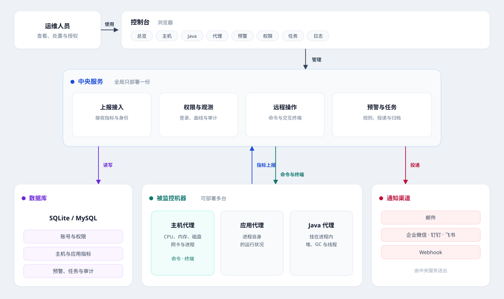
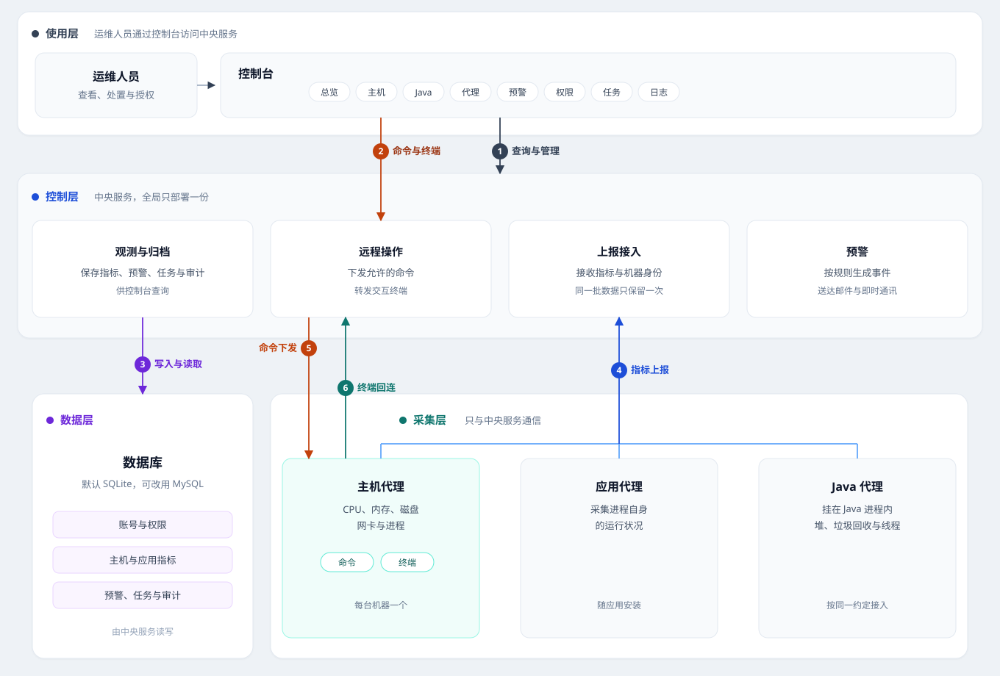

<p align="center">
  <strong>现代化主机与应用监控平台</strong>
</p>

<p align="center">
  Flux Guard 是一款基于 Go 语言开发的主机与应用监控平台。代理部署在每台被监控机器上，由中央服务统一接收指标，集成主机观测、Java 运行时、预警通知、远程操作与权限审计等核心能力。提供控制台查看曲线、处置告警并管理任务，帮助运维团队及时掌握运行状况，为主机和应用构建稳定、可观测的监控层。默认 SQLite 即可启动，生产环境可切换 MySQL。
</p>

---

**目录：** [架构](#架构概览) · [功能](#功能) · [快速开始](#快速开始) · [本地开发](#本地开发) · [安装运行](#安装运行) · [文档](#文档)

---

## 架构概览

<p align="center">
  
</p>

<p align="center"><sub>图 1　部署视图：中央节点、被监控主机与外部通知</sub></p>

<p align="center">
  
</p>

<p align="center"><sub>图 2　逻辑分层：使用层调用控制层，控制层读写数据层，采集层向控制层上报</sub></p>

控制台只访问中央服务。中央服务全局一份，负责保存数据、投递预警，并与各台机器上的代理通信。

| 层 | 职责 |
|----|------|
| 使用层 | 在控制台查看总览、主机、Java 和代理，处理预警，管理权限与任务，查阅操作记录 |
| 控制层 | 全局只部署一份。接收上报、校验身份、保存观测数据、按规则产生预警，并负责命令和交互终端 |
| 数据层 | 保存账号、权限、指标、预警、任务和审计。默认 SQLite，可改用 MySQL |
| 采集层 | 安装在被监控机器上。主机代理采集 CPU、内存、磁盘、网卡和进程；应用代理采集自身进程；Java 代理挂在 Java 进程内，采集堆、垃圾回收和线程 |

一台机器可以同时安装多种代理。其它语言的代理按同一约定上报即可。预警可以送到邮件、企业微信、钉钉、飞书或 Webhook。

图 2 中的编号是层与层之间的交互：

1. 控制台向中央服务查询指标、处置告警，并管理权限与任务。
2. 控制台经中央服务对主机下发命令，或打开交互终端。
3. 中央服务写入并读取账号、指标、预警、任务和审计。
4. 主机代理、应用代理和 Java 代理按间隔上报。同一批数据只保留一次。
5. 命令先由中央服务直接发给主机代理。目标暂时不可达时，改由主机代理来取，执行后回传结果。命令只包含允许的动作。
6. 交互终端默认关闭。打开之后由主机代理主动连回中央服务，主机在内网中也可以使用。终端画面在会话期间转发。

两分钟没有上报的代理会显示为离线。分层、表结构和接入约定见 [架构说明](docs/01-architecture.md)。

---

## 功能

| 能力 | 说明 |
|------|------|
| 主机 | 当前用量、历史曲线，以及按主机设置的预警规则 |
| Java | 堆、垃圾回收和线程 |
| 应用 | 进程自身的运行状况 |
| 预警 | 模板、通知渠道、事件与恢复 |
| 远程操作 | 对主机执行允许的动作，可打开交互终端 |
| 权限 | 按角色授权。页面和其中的操作分别授予 |
| 任务 | 按时间执行内置任务，例如清理过期数据 |
| 审计 | 控制台上的管理操作，以及代理上的命令和终端使用记录 |

---

## 快速开始

需要 **Go 1.25+**、**Node.js 20+**、**pnpm 9+**。安装包的启动方式见 [安装运行](#安装运行)。

| 项 | 值 |
|----|----|
| 控制台 | http://127.0.0.1:5174/fluxguard/ |
| 管理员 | `admin` / `fluxguard` |
| 只读账号 | `viewer` / `fluxguard` |
| 数据库 | 默认 SQLite，文件 `data/flux_guard.db` |

### 本地开发

数据库组件和界面组件放在本仓库的同级目录。`go.mod` 使用 `../dbx`，控制台依赖 `../niuma-ui`。

| 组件 | 仓库 |
|------|------|
| dbx | https://github.com/fluxsce/dbx |
| niuma-ui | https://github.com/Blair-Shang/niuma-ui |

在 `flux-guard` 根目录执行：

```bash
git clone https://github.com/fluxsce/dbx.git ../dbx
git clone https://github.com/Blair-Shang/niuma-ui.git ../niuma-ui
cp -n configs/server.yaml.example configs/server.yaml
pnpm --dir ../niuma-ui install
pnpm --dir web install
pnpm dev
```

`pnpm dev` 启动中央服务（`:8080`，读 `configs/server.yaml`）和 Vite（`5174`，`/fluxguard/api` 转到 `8080`）。打开上面的控制台地址登录。首次启动写入数据库和账号。本机 `configs/*.yaml` 留在本机。

Windows 下复制配置：

```powershell
if (-not (Test-Path configs\server.yaml)) { Copy-Item configs\server.yaml.example configs\server.yaml }
```

要看本机上报时，另开终端。先从对应的 `configs/*.yaml.example` 复制出 `host.yaml` 或 `app.yaml`，再执行 `go run ./cmd/host` 或 `go run ./cmd/app`。开发上报令牌是 `agt_dev_local`。Java 代理源码在 `agents/java`，配置是 `configs/java.yaml`。

`go test ./...` 跑后端测试。`pnpm --dir web run typecheck` 检查控制台。监听地址和数据库写在 `configs/server.yaml`，也可用前缀 `FLUX_GUARD` 的环境变量覆盖。

### 安装运行

安装包解开后是 `flux-guard/`。中央服务在根目录，用 `scripts/run` 启动和停止。三个代理已经各自打成压缩包，放在 `agents/` 里，拷到目标机器再解压：

| 压缩包 | 解开后的目录 |
|---|---|
| `agents/flux-guard-agent-host.tar.gz` | `flux-guard-agent-host/` |
| `agents/flux-guard-agent-app.tar.gz` | `flux-guard-agent-app/` |
| `agents/flux-guard-agent-java.tar.gz` | `flux-guard-agent-java/` |

主机代理和应用代理的目录里有程序、配置示例和启动停止脚本。Java 代理只有配置示例，用 `-javaagent` 挂进目标进程。第一次启动时，若还没有本机 `configs/*.yaml`，脚本会从示例复制一份。程序只读这份 yaml，不读 example。本机配置留在机器上，不要提交。

中央服务、主机代理和应用代理要在机器重启后自动起来，在各自目录执行一次 `scripts/run/install.sh`（Windows 用管理员执行 `install.ps1`）。这会登记成系统服务并立即启动：Linux 是 systemd，macOS 是 launchd，Windows 是开机任务。服务不把程序输出送进系统日志，日志仍写在安装目录的 `logs/` 里并按大小轮转。重启用同目录的 `restart.sh` 或 `restart.ps1`。取消开机启动用 `uninstall.sh` 或 `uninstall.ps1`。Java 代理不登记。

安装包带有控制台页面。浏览器打开 `http://主机:listen端口/fluxguard/`，例如 `listen` 为 `:8080` 时是 `http://127.0.0.1:8080/fluxguard/`。根路径会转到这个地址。

监听地址和数据库可以在服务配置中修改，也可以用前缀为 `FLUX_GUARD` 的环境变量覆盖。

---

## 文档

| 文档 | 说明 |
|------|------|
| [架构说明](docs/01-architecture.md) | 分层、数据表、命令与终端通道、接入约定 |
| [更新日志](CHANGELOG.md) | 版本记录 |
