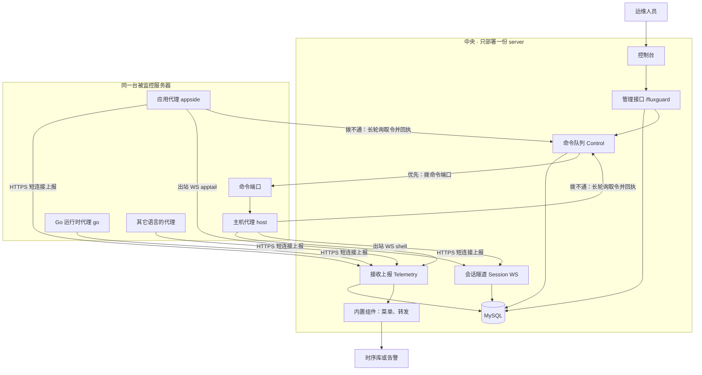
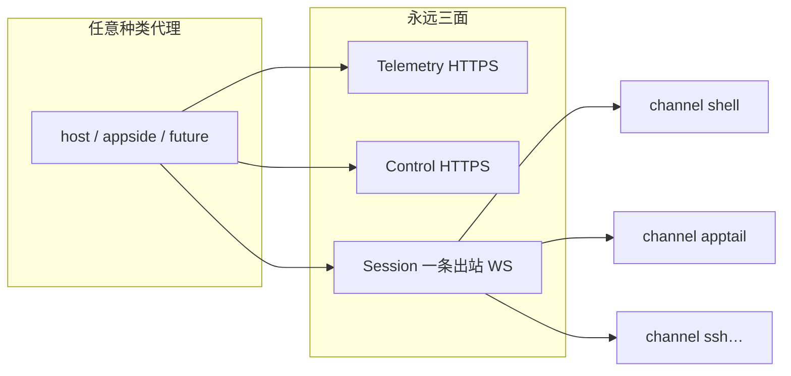
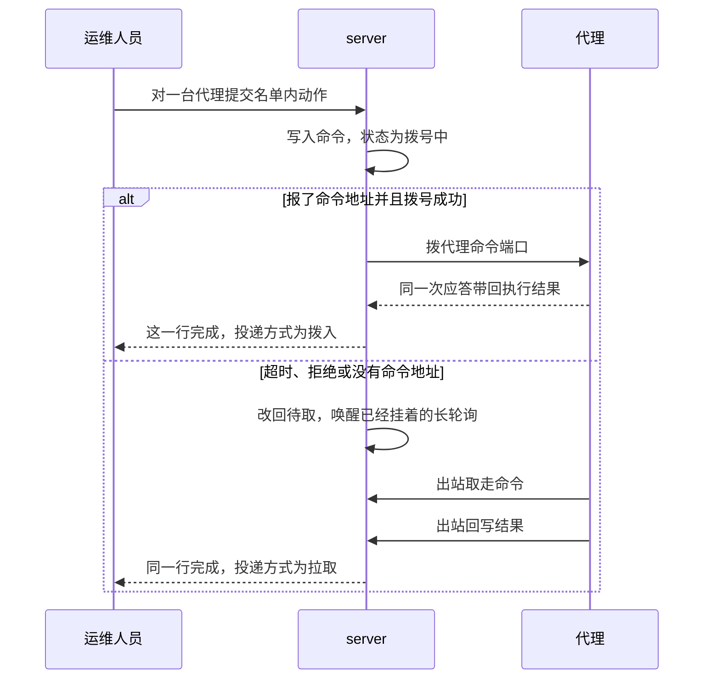
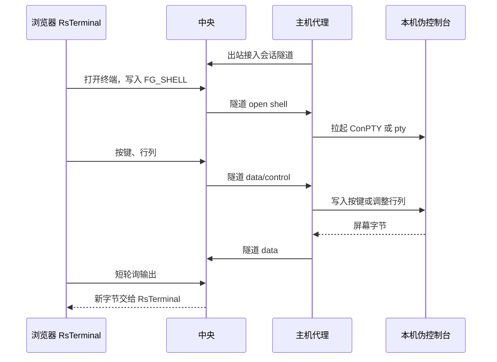

# Flux Guard 架构

运行时中央只部署一份 server。每台被监控机器按种类安装代理：主机代理采 CPU、内存、磁盘容量、磁盘 IO、网卡流量和进程内存；Go 运行时代理只上报自己这个进程；Java 代理挂在 JVM 里采堆和 GC；应用代理一台机器一份，配置里列出这台机器上的各套 Tomcat、JAR 和静态目录并负责换包。一台机器可以同时跑多个种类的代理。代理各自安装、升级和停机，只把批次上报给 server，代理之间不通信。server 不启动代理，也不把代理编进自己的进程。

对齐两边的是通讯协议，不是实现语言。协议放在 `protocol`，规定路径、鉴权头、JSON 正文和应答。Java、Python 或其它语言自己实现一个代理，按这份协议上报即可。协议不是进程。

`common` 放共用代码：主键、YAML 配置读取（viper）、编译写入的产品版本，以及 Go 代理的组批次和上报。口令摘要、令牌摘要、菜单、转发、接入是 server 的内置组件，放在 `server` 下面。通讯字段、路径和重试约定只放在 `protocol`。

## 部署



同一台机器上的代理互不通信。指标走 Telemetry 短连接；终端 / 日志跟读等**连续交互**走 Session 出站 WebSocket；换包等名单动作走 Control。控制台只连中央 `/fluxguard`，不直连代理。

开发时可以在同一台电脑上起 server、host、goruntime 进程，配置里的 `server_url` 指向本机。正式环境中央只跑 server，把需要的代理装到被监控的机器上。

## 三层，加一个共享工具层

| 层 | 目录 | 是不是进程 | 放什么 |
|----|------|------------|--------|
| Server | `server` | 是，中央一份 | 登录、权限、代理登记、接收批次、主机记录、菜单和转发 |
| 主机代理 | `agents/host` | 是，每台机器一份 | CPU、内存、磁盘容量与 inode、磁盘 IO、网卡、TCP、进程内存和 CPU。按机器编号上报 |
| Go 运行时代理 | `agents/goruntime` | 是，跟这个 Go 进程一起装 | 上报本进程的显示名、版本、进程号、协程、堆和 GC。种类 `go`。旧种类 `app` 仍接收，身份写入 `FG_AGENT_GO` |
| 应用代理 | `agents/appside` | 是，一台机器一份，独立进程 | 配置列出这台机器上的各套 Tomcat、Node、脚本、JAR、静态目录或 `files` 制品目录，并指定 `backup_dir`。Tomcat/Node/script/files 填 `base`。换包或升级前把旧内容移进备份目录，再写回原路径；`files` 只换一层目录里的 war/jar/zip、不重启。其它模式重启支持 systemd / Windows 服务 / docker / 本机命令。应用进程退出后代理还在。种类 `appside` |
| JVM 代理 | `agents/java` | 是，挂进目标进程 | 以 `-javaagent` 采集堆、GC、线程，种类 `java` |
| 通讯协议 | `protocol` | 否 | 路径、鉴权头、正文、应答、重试约定。任意语言按这一份实现即可 |
| 共享代码 | `common` | 否 | 主键 `common/id`，YAML 配置 `common/yamlcfg`（viper），对称加解密 `common/crypto`，Go 上报 `common/report`，Go 命令通道 `common/command`，Go 终端通道 `common/shellrun` |

**Server** 管人和目录。它校验用户口令、按按钮码鉴权、签发代理令牌，并接收批次。进来的令牌按 SHA-256 校验；同一把令牌在环境设置里另有密文，拨代理时出示。同一 `tenantId` + `batchId` 只入库一次。口令和令牌摘要在 `server/utils/secret`，不放进 `common`。管理功能按模块目录扩展，见下文「管理端模块」。

**代理** 各自采集自己那一类数据。它不保存用户口令。准入是租户共用的上报令牌。正文里的 `agentCode` 只能是 `protocol` 里登记的 `host`、`go`、`java`、`appside`。已经发出的 Go 进程仍可用旧种类 `app`。其它种类直接拒绝。主机代理再带操作系统机器编号，Go 进程用「显示名@主机名」，Java 代理用「服务名@实例」，服务器按租户、种类和这个编号各保留一行。

**协议** 规定这些交互：

- `POST /fluxguard/api/ingest/v1/batches`
- 头 `Authorization: Bearer <上报令牌>`
- 正文是 `protocol.Request`：`batchId`、`agentCode`、`sentAt`、`samples`、`events`、`host`、`java`、`go`、`appSide`。租户由令牌决定，不写进正文
- 成功应答是 `protocol.Result`
- 单批样本或事件超过 1000 条时，Go 代理拆成多批。网络失败或 5xx 用同一个 `batchId` 再送一次，仍失败则写入 `data/<种类>-spool.jsonl`，下一轮先补报，最多留 400 批；4xx 不重试、不入积压
- 主机代理可带 `host`：主机名、系统、内核、架构、CPU 个数、内存总量、地址列表、开机时间、机器编号、代理版本和 `reportName`。身份写入 `FG_AGENT_HOST`，同一台代理每次上报更新这一行，并同步 `FG_AGENT` 的名称和地址。`reportName` 来自 `configs/host.yaml` 的 `report_name`。配置里的 `description`（代理级）与 appside 每套 `runtimes[].description`（运行时级）上报后写入 `FG_AGENT.noteText` / `FG_APP_INST.noteText`；非空时覆盖控制台备注，空则不改
- Go 运行时代理带 `go`：显示名、Go 版本、进程号、启动时间、主机名、CPU 个数、协程数、堆分配、堆申请、堆对象、GC 次数和累计停顿。身份和最近一次数值写入 `FG_AGENT_GO`，同一进程每次更新这一行，并同步 `FG_AGENT` 的名称。显示名来自 `configs/goruntime.yaml` 的 `report_name`，留空时用程序文件名。同一台机器上的多份进程靠这个名字分开。指标名用 `go.runtime.*`。旧进程若只上报 `app.runtime.goroutine.count` 和 `app.runtime.heap.alloc.bytes`，中央仍把这两个数写入同一张表
- Java 代理带 `java`：应用名、主类、进程号、Java 版本、启动时间、主机名和地址。身份写入 `FG_AGENT_JAVA`，同一代理每次更新一行，并同步 `FG_AGENT` 的名称。JVM 启动时间变化时收口 `FG_JAVA_RUN` 的上一行并另开一代，列表上的 GC 次数是当前这一代启动以来的累计。停顿开销、区间分位、堆前后和晋升未知时记 -1，死锁采集失败时也不写成 0。进程常驻内存是 `jvm.process.rss.bytes`，读不到不报，也不写成 0。判断与曲线共用堆 85%、停顿 200ms/500ms、开销 10%。应用名优先取 `java.appName`，没有时仍接受 `host.reportName`。堆、非堆、元空间写入 `FG_JAVA_HEAP`，分代、代码缓存和堆外写入 `FG_JAVA_POOL`，进程 CPU、类加载和常驻内存写入 `FG_JAVA_RUNTIME`，当前常驻内存同时写在 `FG_AGENT_JAVA`，各回收器累计次数和耗时写入 `FG_JAVA_GC`，两次上报之间的停顿写入 `FG_JAVA_GC_PAUSE`，线程数写入 `FG_JAVA_THREAD`，运行、阻塞和等待写入 `FG_JAVA_THREAD_STATE`，直接内存上限写入 `FG_JAVA_POOL_MAX`，这些表只插入。指标名用 `jvm.*`。列表和详情用最近几个点给出一句判断，曲线在 fg0006
- 主机曲线按类别只插入：`FG_HOST_CPU`、`FG_HOST_CPU_CORE`、`FG_HOST_MEM`、`FG_HOST_DISK`、`FG_HOST_DISK_IO`、`FG_HOST_NET`、`FG_HOST_TCP`、`FG_HOST_FD`、`FG_HOST_PROC`、`FG_HOST_PROC_TOP`。列表和明细读最新一批，点开后按时间画曲线。主机规则在 fg0005，按主机最新指标判断后交给预警发送。

## 代理与中央：三面协议

扩展多少种 agent，对外表面保持三面，避免路径爆炸：

| 面 | 运输 | 路径 | 扩展方式 | 放什么 |
|----|------|------|----------|--------|
| Telemetry | HTTPS POST 短连接 | `/fluxguard/api/ingest/v1/batches` | 正文字段 / `agentCode` | 指标、清单 |
| Control | HTTPS（拨入或长轮询）+ 大文件 HTTPS | `command/v1/*`、制品与代下 | **动作枚举** | 换包、重启、改间隔、自更新 |
| Session | **一条代理出站 WebSocket** | `/fluxguard/api/agent/v1/tunnel` | **通道 kind** | 终端、日志跟读、以后 SSH 等连续流 |



**后续凡「长连接、连续交互」一律走 Session WS**（同一条隧道多路 `channel`）。不上第二条平行长连接，不新开 REST 长轮询会话。Telemetry / Control / 大文件仍用 HTTPS。

列目录、换包、新增制品、运行时启停仍走 **Control**（短拨或 `app.file.list` / `app.runtime.start|stop|restart`），不进 Session。控制台点刷新时中央向代理拉实时清单并写库（含注销已删文件）；Session 解决不了「磁盘删了还不知道」，除非再加代理侧目录监听推送。启动日志跟读仍走 Session `apptail`。

浏览器只连中央。令牌、口令、环境变量值不进隧道帧与跟读正文审计。

### 并发与断线

| 点 | 约定 |
|----|------|
| 连接模型 | **每台代理一条**出站隧道；多路会话用 `sessionId` 复用，不按终端数建连 |
| 并发上限 | 终端 / 跟读各有每用户、每代理路数硬顶；ring 与单帧有字节上限，队列满丢最旧 data |
| 心跳 | 中央定期 ping；写失败或 ping 失败立刻关连接并 Detach |
| 断线 | 代理侧取消本连接上全部通道 goroutine；中央 Detach，不再向旧连接写 |
| 重连 | 代理指数退避重连；接入后中央 **OnAttach 重推**仍打开的 shell / apptail |
| 替换 | 同代理新连接接入时关掉旧连接，避免双写 |

旧 `/api/shell/v1/*` 已移除。SSH 等新终端形态：agent 侧实现后挂新 `channel`，**不开新 REST 会话路径**。

## 操控采集机

指标上报保持短连接的 `POST /fluxguard/api/ingest/v1/batches`。这条链路已经在跑：代理按间隔采集，`common/report` 组批次，`server/web/ingest` 校验令牌后写入主机记录和事件。应答只有是否重复和条数，不携带命令。

命令另开通道。控制台只提交允许名单里的动作，任意 shell 不进名单。一条命令一行记录，拨入和拉取共用这一行，控制台只看这一行的状态和结果。



拨号的连接超时是 2 秒，整次拨号最多约 12 秒。超时太长时，NAT 后面的机器每次都会先空等。拉取连接要一直挂着：拨号失败只有 server 知道，代理不会临时再去连。没有命令时连接空挂，默认约 20 秒，并且短于管理端写超时再留 2 秒；队列里一有待取命令，这根连接马上返回。

同一条命令只执行一次。拨号前把状态从「拨号中」改成「执行中」；拨号没连上就改回「待取」。长轮询只取「待取」。两边用命令号做条件更新，后到的一方看到状态已经变了就不再执行。

### 和现有代码怎么接

协议仍只放在 `protocol`，不放进上报正文。三条路径：

| 方向 | 路径 | 谁发起 | 作用 |
|------|------|--------|------|
| 拨入 | 代理上的 `POST /api/command/v1/exec` | server | 连上则执行并在本次应答里带回结果 |
| 取令 | server 上的 `GET /fluxguard/api/command/v1/wait` | 代理 | 长轮询，只返回已改为待取的命令 |
| 回执 | server 上的 `POST /fluxguard/api/command/v1/results` | 代理 | 把拉取执行的结果写回同一行 |

上报、取令、回执和命令端口都带同一把代理令牌，头仍是 `Authorization: Bearer`。进来的请求用摘要校验。拨号要出示这把令牌，所以环境设置里同一行再留一份可还原的密文，不是另一把密钥。令牌为空时不监听。取令和回执再用 `agentCode` 加 `machineId` 标明机器。

拨号目标必须是回环地址，或这台代理上报过的 IP。其它地址不拨，直接改为待取。开发配置把命令端口绑在 `127.0.0.1:7700`，中央和代理在同一台机器时才能拨到。

表 `FG_COMMAND` 放在 `scripts/db/mysql` 和 `scripts/db/sqlite`，并写进两边的 `init.sql`。一行包括命令号、租户、代理、动作名、参数、状态（拨号中、待取、执行中、完成、失败）、投递方式（拨入、拉取）、结果文本、操作人。这一行就是执行记录。控制台 fg0002 的「操作记录」按代理回看最近命令与回执；日志管理 fg0052 把命令回执与终端账本合成统一时间线。管理端写操作和登录结果由路由上的全局审计写入 `FG_AUTH_AUDIT_LOG`，不挡住命令通道。写接口在绑定后补上对象和一句说明，不记口令、令牌、密钥、环境变量的值和终端按键。查询不记。

代码按这个边界拆开，都不进 `server/web/ingest`：

1. `protocol` 写路径、命令正文和应答。动作名是固定枚举，不接受任意命令行。
2. `server/command` 写入和认领 `FG_COMMAND`。先拨号：代理在主机资料里报了命令地址，并且目标属于这台机器或回环，就带代理令牌去拨；成功则把结果写回并返回给控制台。失败、没有地址或还原不出令牌则改为待取，并唤醒该代理已经挂着的长轮询。
3. 控制台挂在 fg0002，按钮码 `fg0002:command`（立即采集 / 改间隔）与 `fg0002:upgrade`（上传代理包并批量自更新）。对列表里的一台代理下发，页面看这一行从拨号中到完成。拨不通时继续看同一行，直到回执到来。自更新只走长轮询。按钮行在 `FG_AUTH_RESOURCE.sql`，初始授权由 `FG_AUTH_ROLE_RESOURCE.sql` 授给超级管理员。
4. `common/command` 给 Go 代理用：常开长轮询；`command_listen` 有值且配置了 `agent_token` 才开命令端口，并把地址随资料上报。`cmd/host` 的动作是立即再采一轮和修改进程内上报间隔。`cmd/appside` 的动作是替换静态资源、WAR、JAR，升级它看守的运行时，以及按备份路径回滚（`app.file.rollback`，备份须在本机 `backup_dir` 内）。应用换包与回滚由 fg0008 下发，默认金丝雀先 1 台再「继续下一批」。`agent.self.update` 让 host / go / appside 从中央拉取自身安装包并替换后重启（首次部署仍手工安装；下发只走长轮询；须匹配 goos/goarch；默认金丝雀分批；失败回滚上一版二进制）。名单之外的命令行仍然拒绝。
5. 修改上报间隔只活在这次进程里，重启后回到 `interval_sec`。重启服务等要另增名单项，仍不开放任意 shell。

没配 `command_listen` 或 `agent_token` 的代理只有拉取这一条路。

## 交互终端

交互终端不进命令名单，也不走 `FG_COMMAND`。走 Session 面：代理出站 WebSocket（`TunnelChannelShell`）。开关在主机配置 `shell_enabled`，默认关闭；控制台按钮码是 `fg0002:shell`。只有打开的那个人能看和输入，租户管理员可以关掉别人的终端。

终端会话账本在 `FG_SHELL_AUDIT`：打开、关闭各记一条；回车确认的一行命令记为 `INPUT`（最长约 200 字）。方向键、窗口缩放和屏幕输出不落库。控制台「操作记录」与 fg0052 代理操作日志都可回看；谁打开过终端仍可在 fg0051 系统操作日志里查到控制面摘要。



`FG_SHELL` 只记会话：谁、哪台代理、开着还是关了。按键和屏幕字节在中央进程的内存管道里，不落库。中央重启后会话行还在，字节流会丢；代理重连隧道时中央重推仍打开的会话。Windows 用 ConPTY，Linux 用 `/dev/ptmx`。页面用 `RsTerminal`。若以后要 SSH 或其它终端形态：agent 侧实现后挂隧道新 `channel`（或扩展 shell meta），控制台仍只连中央。

资源有上限，避免一路终端把进程撑大：

| 项 | 上限 |
|----|------|
| 每人在一台代理上同时打开 | 8 |
| 一台代理上同时打开 | 32 |
| 一路输入排队 | 64KB，满了拒绝新按键 |
| 一路输出缓冲 | 256KB，超出丢掉更早的字节 |
| 代理单次推送 | 32KB |
| 回车审计 | 一行最多记 200 字到 `FG_SHELL_AUDIT`，方向键和单独按键不记 |

关掉终端后删掉 `FG_SHELL` 这一行，并释放内存缓冲；关闭事件写入 `FG_SHELL_AUDIT`。以前标成关闭、仍留在库里的行，会在清理时删掉。页面每 4 秒报一次「还在看」；浏览器关掉页面时也会立刻请求关闭。超过 90 秒没有这个信号，中央删掉会话。这个检查每 30 秒扫全部打开的终端，不依赖代理还在拉列表。代理下一轮看不到这一行，就拆掉伪控制台。等按键的时间短于接口写超时，避免连接被服务器提前掐断。Windows 上命令行放进作业对象，代理进程退出时作业一起结束。Linux 上伪控制台主端留在代理进程里，进程退出时内核挂断前台进程组；正常关闭还会结束整个前台进程组。忽略挂断的后台任务，例如 `nohup`，不会被这一下收掉。

## 服务器内置组件

| 组件 | 目录 | 做什么 |
|------|------|--------|
| 口令与令牌摘要 | `server/utils/secret` | 登录口令只存 bcrypt，不能解密。上报令牌进来时用 SHA-256 校验，同一把令牌另存密文，供拨代理时出示 |

## 目录

```text
cmd/server          server 进程入口，只做组装
cmd/host            主机代理入口
cmd/goruntime       Go 运行时代理入口。只上报自己这个进程
cmd/appside         应用代理入口。换包和运行时升级走这里，不进主机代理
server/auth         用户、角色、资源
server/utils        server 进程工具：secret（口令与令牌摘要）、const（errcode、limits）。只给 server 用，不进 common
server/helper       server 辅助公共逻辑：agent（FG_AGENT 台账）、apprelease / agentrelease（制品落盘，记录分别在 FG_APP_RELEASE / FG_AGENT_RELEASE）
server/web          管理端装配；模块在 views 下按目录扩展
server/web/ingest   上报接收入口，分层与 views 相同：routes 在 init 自注册，另有 controllers、service、dao。不进模块号，路径仍是 POST /fluxguard/api/ingest/v1/batches
server/command      命令队列：先拨代理，拨不通改为待取。子包 models / service / routes；根包是门面
server/alert        预警模板、渠道、事件与投递。子包 models / validate / channel / template / event / service；根包是门面
server/component    组件直连采集。catalog 是种类目录，conn 是连接，sched 按间隔拨号，redis / mysql / mongo / zk / nacos 是编进进程的探针。Kafka 由 plugins/kafka 的官方客户端插件采集。bridge 把外置插件的调用结果写入采集表
server/shell        交互终端会话 FG_SHELL，字节只留在本进程内存管道；开闭与回车命令写入 FG_SHELL_AUDIT
server/plugin       外置插件进程。按 plugins/manifests/*.yaml 启动和停止，只把一次调用的结果交回。帧和信封在 protocol
server/config       本进程监听配置。产品版本不在 YAML 里
agents/host         主机采集：CPU、内存、磁盘、流量、连接、句柄、进程内存
agents/goruntime    Go 进程上报自己：身份、协程、堆、GC
agents/appside      应用代理：一台机器一份，列出各套 Tomcat、JAR、静态目录或 files 制品仓
agents/java         JVM 代理：-javaagent 采集堆、GC、线程
protocol/           通讯协议：字段、路径、鉴权头、应答、重试
common/id           两边共用的主键
common/yamlcfg      两边共用的 YAML 配置读取（viper）
common/crypto       两边共用的 AES-GCM，前缀 ENCY_。不用于登录口令
common/report       Go 代理共用的组批次和上报，不采集
common/command      Go 代理的命令端口和长轮询。端口校验代理令牌
common/agentupdate  Go 代理自更新：下载安装包、保留配置、旁路替换二进制并重启
common/shellrun     Go 主机代理的交互终端：主动连中央，本机拉起伪控制台
common/buildinfo    产品版本。本地读取仓库根 package.json，发行构建用 ldflags 覆盖
web/                控制台，由 server 托管
configs/            示例配置 *.yaml.example。本机 *.yaml 由启动脚本复制，不提交
scripts/run         当前目录里那个程序的启动与停止。发行包里代理在 agents/*.tar.gz，解开后各自成目录
scripts/db/mysql    中央库表，MySQL
scripts/db/sqlite   同一套表的 SQLite 脚本，不含部门
```

## 仓库里的参考进程

`cmd/server` 是控制面的参考进程。控制台是另一份前端，开发时由 Vite 转到这个进程；构建后可以由同一个进程托管 `web/dist`。

`cmd/host`、`cmd/goruntime` 与 `cmd/appside` 是各司其职的 Go 代理进程。它们各自采集，再调用 `common/report` 按 `protocol` 上报。换一种语言实现代理时，不需要这些进程，只需要遵守 `protocol`。

## 外置插件怎么挂上

每个插件一份 `plugins/manifests/<编码>.yaml`。清单按 `bridge`、`session`、`runtime`、`ipc`、`lifecycle` 分节，写出编码、语义化版本、组件种类、会注入口令的方法、Windows 与 Unix 的可执行文件、本机通道和 `lazy` 启动。可执行文件相对 `plugins` 目录。`id` 形如 `com.fluxguard.kafka`。`server/plugin` 启动时加载这个目录并登记，第一次调用再拉起进程，种类是 `SERVICE`，退出时全部停下，只把调用结果交回。采集入库、维护参数和文件校验在 `server/component/bridge`。调用哪一个方法以清单为准。组件口令不写进清单，只在 `session.credential_methods` 列出的方法里送出。通道地址写在 `ipc` 里，中央放进该进程的 `FG_PLUGIN_ADDRESS`。多笔调用各走一条连接，空闲连接会留下复用。同一个插件可以同时处理多笔。调度一轮最多同时采集 32 路，名额满了的留到下一轮。帧是 4 字节小端长度加一帧 JSON，应答带回 `id` 与 `traceId`，失败带稳定 `errorCode`。进程不拿库、不挂 HTTP。

## 管理端模块

管理接口按 gateway 的方式拆开：一个功能一个目录，路由在模块自己的 `init` 里登记，装配文件只做空白导入。

```text
server/web/routes           前缀 /fluxguard、模块登记、按钮鉴权
server/web/moduleimports    唯一的模块导入清单
server/web/views/auth       登录、退出、当前用户、菜单
server/web/views/fg0001     总览（0001–0020 运行观测）
server/web/views/fg0002     代理
server/web/views/fg0005     主机列表（当前值）、曲线和主机预警规则
server/web/views/fg0006     Java 应用列表（当前值）和历史曲线
server/web/views/fg0007     组件监控：按种类列出实例，详情按页签看当前值和曲线
server/web/views/fg0021     用户（0021–0040 系统管理）
server/web/views/fg0022     角色
server/web/views/fg0023     资源
server/web/views/fg0024     环境设置（接口超时、会话、分页、环境变量、上报令牌）
server/web/views/fg0025     任务调度（Job 接口：手动 / 间隔 / 指定时间 / cron，超时与失败重试，参数对象，执行结果与历史日志）
server/web/views/fg0026     插件管理（只读目录：版本、接入的组件、进程状态和清单里的方法。不提供启停）
server/web/views/fg0041     预警模板（标题和正文按渠道种类。0041–0050 是预警号段，不必占满）
server/web/views/fg0042     通知渠道（邮件、企业微信、钉钉、QQ、飞书、Webhook、短信；渠道关联模板）
server/web/views/fg0043     预警事件（确认、恢复，页内带投递记录）
server/web/views/fg0051     系统操作日志（0051–0070 日志管理，只读查询 FG_AUTH_AUDIT_LOG）
server/web/views/fg0052     代理操作日志（只读 UNION FG_COMMAND 与 FG_SHELL_AUDIT）
server/web/views/fg0008     应用管理（运行观测）。左侧运行时由代理配置上报；右侧可刷新清单、上传更新或上传新增制品，换 WAR、JAR、Node、脚本、静态资源和运行时升级都在这一页
```

控制台按同一编号拆开，目录保持扁平。号段只用来占位，避免不同功能挤在同一段号里：0001–0020 运行观测，0021–0040 系统管理，0041–0050 预警管理，0051–0070 日志管理，其后每 20 号一段。侧栏和面包屑显示授权接口里的分组名，不显示号段。共用请求在 `web/src/api`：axios 实例、拦截器、`createApi`。一个模块一个 `web/src/views/fg00xx`，里面用 `createApi(moduleApiPrefix('fg00xx'))`。`web/src/router` 只负责把视图挂到路径。登录在 `web/src/views/auth`，对应后端 `views/auth`。

每个编号目录里是 `routes`、`controllers`，查表放该模块的 `dao`。`routes` 在 `init` 里调用 `RegisterModuleRoutes`，写接口上用 `RequireButton("fg0002:edit")` 这类按钮码。按钮码写在 `FG_AUTH_RESOURCE`。dao 使用鉴权服务交出的连接，不另开库。

新增一个管理功能：

1. 建 `server/web/views/fg00xx/routes` 和 `controllers`。
2. 在 `server/web/moduleimports/imports.go` 加一行空白导入。
3. 在权限种子里加上对应的模块和按钮码。
4. 控制台建 `web/src/views/fg00xx`（页面和 `api`），并在 `web/src/router` 挂上。接口用 `createApi(moduleApiPrefix('fg00xx'))`，前缀与后端模块目录同名。模块工具写在该目录的 `ai.ts`，并由 `web/src/ai/modules.ts` 引入。页面 setup 调用 `useModuleAi`，只上报当前场景。

代理上报留在 `POST /fluxguard/api/ingest/v1/batches`，实现在 `server/web/ingest`，不进某个视图模块号。任何语言的代理都只依赖这条契约。每次上报只更新 `FG_AGENT`、`FG_AGENT_HOST`、`FG_AGENT_JAVA`。主机 CPU、内存、磁盘容量、磁盘 IO、网卡、TCP/UDP 连接、文件句柄、进程汇总和占用靠前的进程各插入记录表。Java 堆、GC、线程各插入记录表。fg0005 列表读最新一批，点进一行看当前分类和曲线，主机规则也在这一页。fg0006 同样读 Java 当前值和曲线。fg0007 维护 Redis、MySQL、MongoDB、Kafka、ZooKeeper、Nacos 的连接，由中央服务按间隔拨号。曲线写入 `FG_COMPONENT_REDIS_METRIC` 这一类采集表。列表要看的当前值覆盖到 `FG_COMPONENT_REDIS` 这一类当前值表，每个连接一行，字段不超过 32 列。列表只查这张表。控制台左侧按种类进入，实例表直接显示这一类的当前值。详情页签记在 `FG_COMPONENT_PANEL`，代码在 `server/component/panel`，按种类分开；终端页用按钮 `fg0007:shell`，每种组件以后接自己的终端。种类按钮是 `fg0007:redis` 这一类编码。预警是 fg0041 模板、fg0042 渠道、fg0043 事件。系统操作日志在 fg0051，读 `FG_AUTH_AUDIT_LOG`。代理操作日志在 fg0052，读 `FG_COMMAND` 与 `FG_SHELL_AUDIT`。

## 控制台 AI 接入

助手还没做。工具目录和当前页面分开，后期模型按 function calling 的形状接入。

每个模块在 `web/src/views/fg00xx/ai.ts` 用 `defineTools` 登记工具。工具名是 `模块.动作`，例如 `fg0002.register`。参数带类型、必填和枚举。`resourceCode` 对齐按钮码，例如 `fg0002:edit`。`platform` 工具直接调用该模块已有接口，页面关着也能执行。`scene` 工具只在页面打开并 `bindScene` 之后执行，用来驱动当前界面。扩展模块同样调用 `defineTools`，名字冲突会在启动时抛错。新的内置模块要在 `web/src/ai/modules.ts` 加一行引入。

页面 `useModuleAi` 只上报当前场景：模块号、标题、快照。快照不放口令、令牌明文和环境变量的值。工具返回值也会去掉这些字段。

`window.__fgAi` 提供 `tools`、`context`、`invoke`、`audits`。`tools()` 是当前账号可见的工具说明。`write` 必须带 `{ confirm: true }`。客户端按已授权模块过滤目录；按钮是否允许仍由服务端鉴权。按钮码进入会话之后，可以用 `registerAiPermission` 换成更细的判断。助手面板以后挂到 `#fg-ai-dock`。

## 权限

表和编码对齐 gateway：

- 表名 `FG_` 前缀、大写、下划线。字段 camelCase。不用自增，不用字段名 `id`。
- 主键一般是 `(tenantId, 业务Id)`。
- 开关只用 `Y` / `N`，例如 `activeFlag`、`statusFlag`。
- 每张业务表带 `addTime`、`addWho`、`editTime`、`editWho`、`oprSeqFlag`、`currentVersion`、`activeFlag`、`noteText`、`extProperty`。
- 每张表有 `(tenantId, addTime)` 索引，供按租户和创建时间归档。审计表沿用 `IDX_FG_AUDIT_TIME`。
- 新表预留列只到 `reserved5`，宽度用 64、100、255 分档。

不设部门。用户通过 `FG_AUTH_USER_ROLE` 归到角色，角色通过 `FG_AUTH_ROLE_RESOURCE` 获得资源。资源四层是 `GROUP`、`MODULE`、`BUTTON`、`API`。程序按 `resourceCode` 鉴权，不会把模块自动展开成按钮，超级管理员也不例外。新库的初始授权在 `FG_AUTH_ROLE_RESOURCE.sql`：超级管理员拿到当时全部有效资源，只读角色拿到分组、模块，编码以 `:search`、`:view` 结尾的按钮，以及组件监控的种类按钮（`fg0007:redis` 这一类）。打开终端不给只读角色。之后的增删都在角色页完成。组件监控的按钮写在 `FG_AUTH_RESOURCE.sql`，种类和页签的初始行写在 `FG_COMPONENT_KIND.sql`、`FG_COMPONENT_PANEL.sql`。启动时不再补这些行。

数据权限表保留 `scopeValue`。`filterCondition` 只是对齐 gateway 的保留列，应用不能把它拼进 SQL。

用户口令用 bcrypt，和 gateway 的 `HUB_USER.password` 一样，不能从库里还原明文。开发哈希对应口令 `fluxguard`。需要还原原文的值走 `common/crypto`，不写进用户口令。上报令牌的校验仍是 SHA-256；拨号出示的是同一把令牌，因此环境设置里还有它的密文。

## 上报的数据放哪

主机指标按类别写入 `FG_HOST_*`。Java 堆、内存池、运行时、GC、停顿、线程、线程状态和内存池上限写入 `FG_JAVA_HEAP`、`FG_JAVA_POOL`、`FG_JAVA_RUNTIME`、`FG_JAVA_GC`、`FG_JAVA_GC_PAUSE`、`FG_JAVA_THREAD`、`FG_JAVA_THREAD_STATE`、`FG_JAVA_POOL_MAX`。上报里的事件写入 `FG_EVENT_POINT`。存储走 dbx，配置在 `db` 下。`db.dsn` 直接作为连接串；留空时用主机、端口、账号和库名拼出 MySQL 连接串，或把 SQLite 文件路径写在 `db.database`。默认 `sqlite` 文件库。建表语句每次启动都可以再执行，用来补上后来新增的表。开发种子单独初始化，`FG_SCRIPT_INIT` 里有 `seed` 记录后不再执行。新表同时放进 `scripts/db/sqlite` 和 `scripts/db/mysql`，并写进两边的 `init.sql`。启动代码只按这份清单执行，不再另写表名或补丁。业务 SQL 用 `@name`。预警使用 `FG_ALERT_*`。

长期数据走服务器的内置转发：例如再写一个组件把同一批样本写到 ClickHouse，或转成 Prometheus remote write。代理不用知道后面是哪一种库。

代理两分钟没有心跳，控制台把它显示为离线。这个判断在查询时算，不另开状态机。

## 骨架还没做的事

- Oracle、SQL Server 脚本和驱动。当前登记了 sqlite 和 mysql。
- 登录日志表 `FG_LOGIN_LOG` 的写入。审计表 `FG_AUTH_AUDIT_LOG` 已由管理端全局中间件写入，控制台在 fg0051 查看。
- 出箱转发、代理离线告警。系统任务由 `server/job` 按已登记 Job 调度（手动、间隔、指定时间、任意五段 cron），同一任务执行中不重叠，单次调用有超时，失败按策略重试。参数对象原样传入，结果写入 `FG_JOB` 与 `FG_JOB_LOG`。数据归档实现在 `server/retention`，控制台在 fg0025。
- 菜单扩展页面的真实业务，目前 `/alerts` 是占位。
- 全平台助手界面。页面动作和快照已经登记，见「控制台 AI 接入」。
